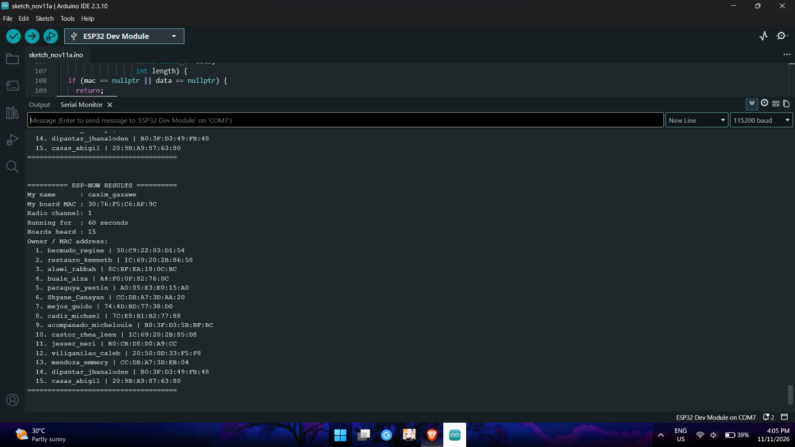

# My ESP-NOW Results

| Item | My result |
| :--- | :--- |
| Name  | casim_gazawe |
| My board's MAC address | `30:76:F5:C6:AF:9C` |
| Number of boards heard | 15 |
| MAC addresses heard | All 15 addresses are listed below. |
| Date and time of the window | November 11, 2026, during our scheduled 2:00 PM to 5:00 PM BCA 188 lab (UTC+8). |

## Boards my ESP32 heard

I recorded these addresses from my own Serial Monitor output. Owner names
are the labels sent by the other boards. The count excludes my own board.

| No. | Owner name shown (optional) | MAC address |
| :--- | :--- | :--- |
| 1. | bermudo_regine | `30:C9:22:03:D1:54` |
| 2. | restauro_kenneth | `1C:69:20:2B:86:58` |
| 3. | alawi_rabbah | `8C:BF:EA:18:0C:BC` |
| 4. | buale_aiza | `A4:F0:0F:82:76:0C` |
| 5. | paraguya_yestin | `A0:85:E3:E0:15:A0` |
| 6. | Shyane_Canayan | `CC:DB:A7:3D:AA:20` |
| 7. | majos_guido | `74:4D:BD:77:38:D0` |
| 8. | cadiz_michael | `7C:E8:B1:B2:77:88` |
| 9. | acompanado_michelouie | `B0:3F:D3:5B:BF:BC` |
| 10. | castor_rhea_leen | `1C:69:20:2B:85:D8` |
| 11. | jesser_neri | `B0:CB:D8:D0:A9:CC` |
| 12. | viliganilao_caleb | `20:50:0D:33:F5:F8` |
| 13. | mendoza_emmery | `CC:DB:A7:3D:EB:04` |
| 14. | dipantar_jhanaloden | `B0:3F:D3:49:FB:48` |
| 15. | casas_abigil | `20:9B:A9:87:63:80` |

## My Serial Monitor screenshot

## My screen recording

[Watch my 30-second Serial Monitor recording](casim_SerialMonitor.mp4)
